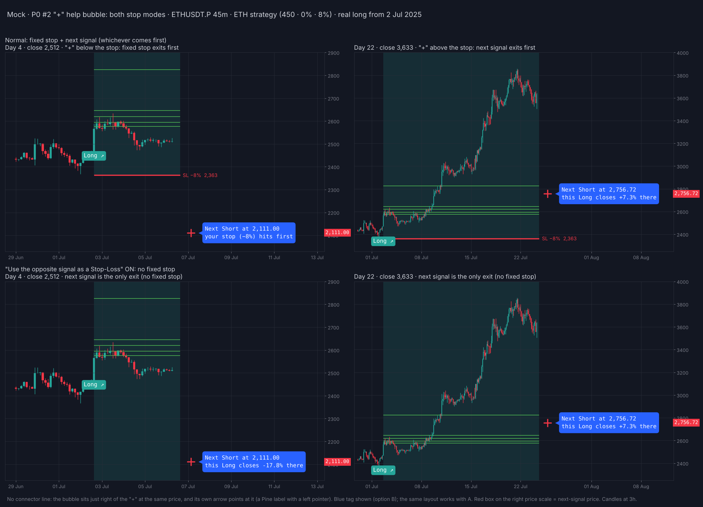
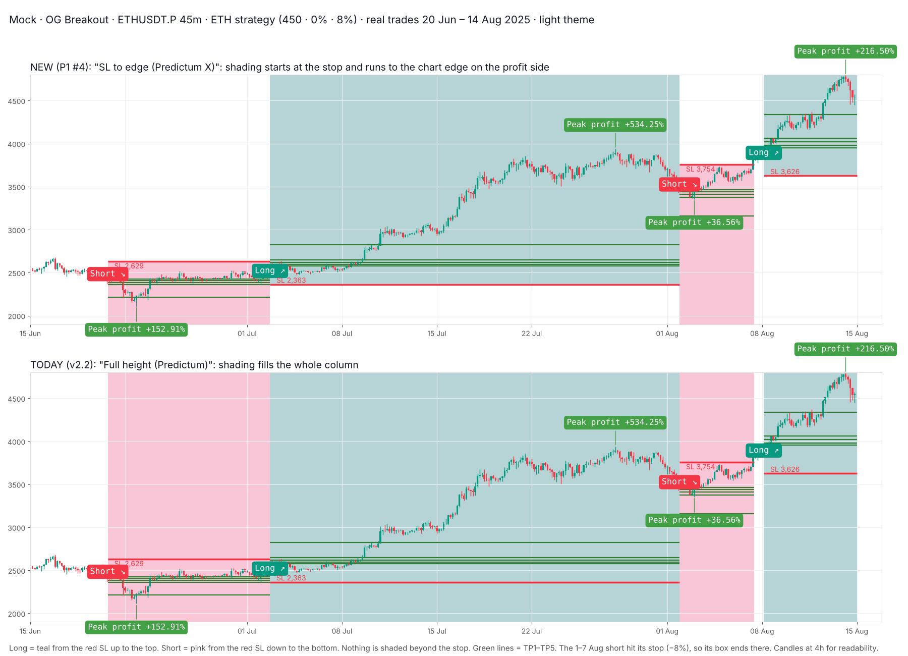
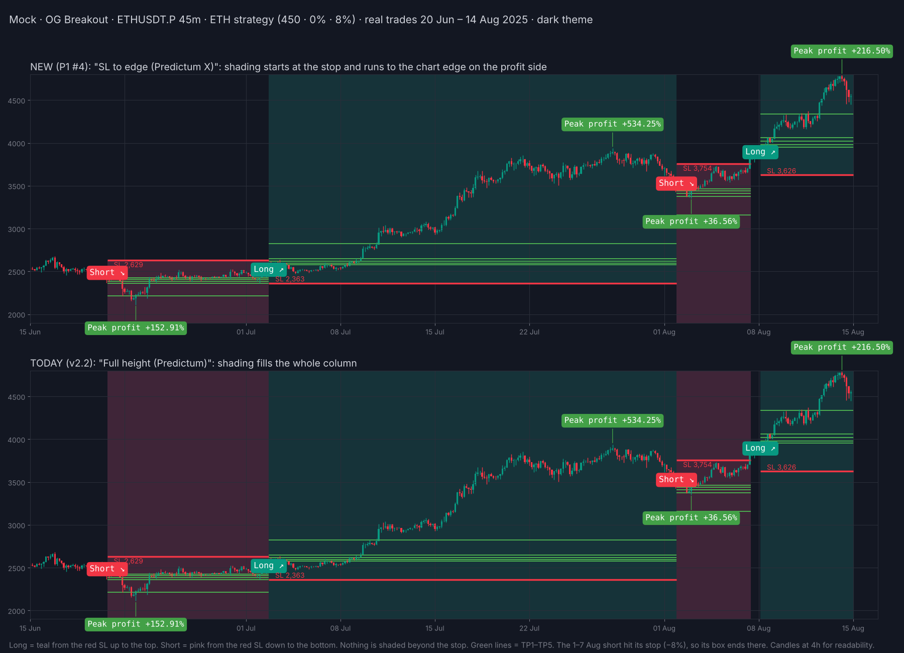
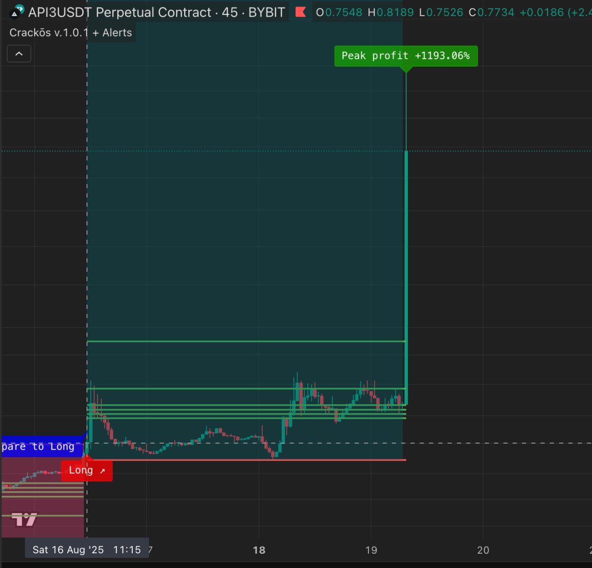
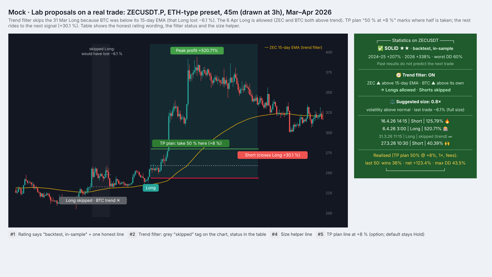
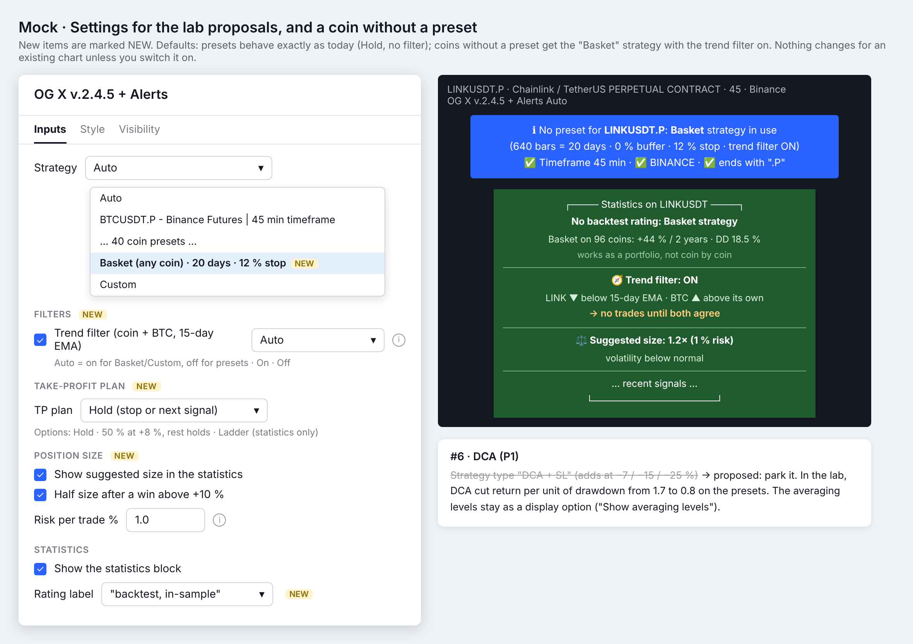

# OG Breakout — approved UI mocks

These are the design mocks agreed on 15 Oct 2026 for **v2.3**. They show what the build must look like. Each mock uses real trades: Binance ETHUSDT.P, ETH strategy (450 bars / 0 % buffer / 8 % stop), from Jul–Aug 2025. Candles are drawn at 3–4h so they are easy to read; the indicator itself runs on 45m.

Build tasks live in [`BUILD_QUEUE.md`](../../BUILD_QUEUE.md). This file records **what was decided and why**.

## Approved

### P0 #2: next-signal "+" and blue tag on the current trade

- **"+" during a trade.** While a trade is open, the opposite-side "+" is always shown. It sits at the price where the next signal would flip the trade. It is drawn at normal size, in the side colour: red for the next Short, green for the next Long. Compare it with the red stop line: whichever is closer to price is the real exit.
- **Blue tag** (option B, Predictum style).
  - White monospace text.
  - Sits just right of the "+" at the same price, with a gap and a small left pointer. There is no connector line.
  - Placed in the empty space after the last candle, so it never covers price.
- **Wording.**

  | Case | Tag text |
  |---|---|
  | Normal stop, "+" inside the stop | Next Short at 2,756.72 / this Long closes +7.3% there |
  | Normal stop, "+" beyond the stop | Next Short at 2,111.00 / your stop (−8%) hits first |
  | "Use the opposite signal as a Stop-Loss" on (no fixed stop) | Next Short at X / this Long closes ±x% there |

  The same wording applies the other way round during a Short ("Next Long at …").
- **Price-scale marker.** A small box in the side colour on the right price scale, at the next-signal price.
- **Setting.** HELPER SETTINGS → "Show next-signal tag on the current trade" (on by default). Turning it off hides the blue tag only; the "+" and the price-scale marker stay.
- **Why.** The "+" already marks the flip price, so no extra lines are needed. The tag adds the plain-language result. Colour means one thing only, the signal side; the words say whether the result is good or bad.

### P0 #3: Predictum X–style trade background, light and dark
| Light | Dark |
|---|---|
|  |  |

- **Shading.** It starts at the stop line and runs to the chart edge on the profit side.
  - Long: teal from the stop up to the top.
  - Short: pink (light theme) or maroon (dark theme) from the stop down to the bottom.
  - Nothing is shaded beyond the stop. The shading runs from the entry candle to the exit candle.
- **Theme.** The colours follow the existing "Light theme" switch. Dark mode uses deeper and more transparent tints, so candles and TP lines stay readable.
- **Setting.** Under "Highlight the background", choose "SL to edge (Predictum X)" (default) or "Full height (Predictum)". The top panel in each mock is the new style; the bottom panel is the old full-height style, for comparison.
- **Reference.** Predictum X in dark mode (API3, Bybit 45m):

  

## Superseded (kept for history)
| # | Mock | Why it was replaced |
|---|---|---|
| 1 | [Trailing next-signal line](superseded/1_trailing_next_signal_line.png) | A dashed line that follows price was too busy. |
| 2 | [Exit stub with ◀ EXIT tag](superseded/2_exit_stub.png) | The "+" from P0 #2 already shows the same thing. |
| 3 | [Big "+"](superseded/3_big_plus.png) | The "+" was too large. |
| 4 | [Profit/loss-coloured tag](superseded/4_pnl_coloured_tag.png) | Red and green meant two different things, which was confusing. |
| 5 | [Tag colour A vs B](superseded/5_tag_colour_A_vs_B.png) | B (blue) was chosen. |
| 6 | [Plain wording with connector line](superseded/6_plain_wording_with_connector.png) | The connector line was not needed. Also showed −17.8% when the stop actually exits first at −8%. |
| 7 | [Both stop modes with connector line](superseded/7_both_stop_modes_with_connector.png) | Replaced by the version without the line. |

## v.2.4.5: research-lab proposals (approved 17 Oct 2026)
| Real trade (ZEC, Mar–Apr 2026) | Settings and a coin without a preset |
|---|---|
|  |  |
